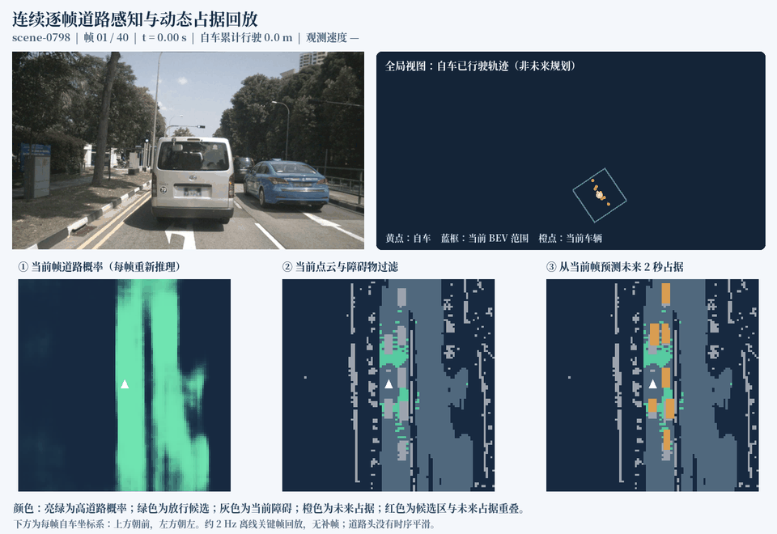
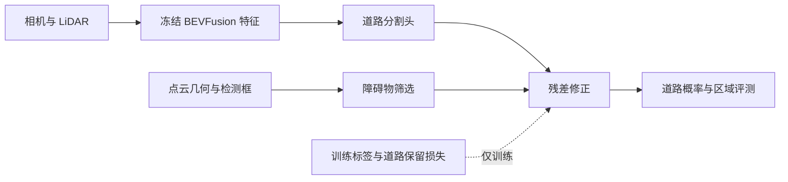

# BEV Road Segmentation and Geometric Traversability

基于相机与 LiDAR 的 BEV 道路分割、障碍物几何筛选及道路保留约束。
使用冻结的预训练 BEVFusion 特征训练道路分割头，在车辆周围 **48 m × 48 m** 的区域输出 **96 × 96** 栅格预测；结合点云与检测框分析道路区域内的障碍物占据。

## 连续场景回放与动态占据

已接入雷达辅助跟踪与 GRU 轨迹预测，形成随实际采集帧更新的道路感知与未来车辆占据演示。下图来自 `scene-0798` 的 **40 个连续关键帧、19.50 秒**，自车行驶约 **128.52 米**。每帧重新提取相机 / LiDAR 特征并运行道路头，前视画面、当前几何筛选与未来 2 秒占据同步更新；右上角展示已观测的自车轨迹。



[回放说明与复现步骤](docs/DYNAMIC_REPLAY.md) · [交互回放 HTML](results/rolling_dynamic_v1/report.html)（下载后在浏览器打开） · [逐帧验证记录](results/rolling_dynamic_v1/verification.json)

这是约 2 Hz 的离线关键帧回放，道路头仍为单帧模型；没有新增训练，也没有测量完整系统的实时性能。未来运动预测目前限于小汽车。当前缺少地面证据或被障碍物阻挡的区域，不会仅因预测车辆离开而获得放行。



## 工作内容

- nuScenes 地图标签生成、坐标变换和统一栅格对齐。
- 相机 / LiDAR / 融合特征的道路分割头对照。
- 地面回波、离地高度与 3D 检测框车身占据范围的联合筛选。
- 对训练中基线正确识别的道路，约束修正后 logit 的过度下降；保护掩码只用于训练，不进入推理。
- 开发集约束选模，报告 IoU、召回率、人行道误放行及失败案例。
- 将当前道路候选区与 CV / CTRV / GRU 未来车辆占据对齐，独立评估冲突栅格与有效覆盖，并实现连续传感器帧回放。

## 已有实验记录

道路保留约束实验，三个种子 17 / 29 / 43 的均值：

| 评测范围 | 方法 | 道路 IoU（%） | 道路召回（%） | 人行道误放行栅格 |
|---|---|---:|---:|---:|
| 原验证子集：150 场景 / 542 帧 | 固定基线 | 77.4529 | 89.0637 | 12,543 |
| 同上 | 道路保留约束 | **78.0496** | **89.1802** | **11,112.3** |
| 保留场景：27 场景 / 108 帧 | 固定基线 | 73.0043 | 88.2223 | 1,382 |
| 同上 | 道路保留约束 | **73.4920** | **88.4584** | **1,175.7** |

范围限制：这些是既有诊断集合，**不是新盲测或完整 nuScenes 像素级官方基准**。个别种子召回未达到开发集设定目标；相对更激进的旧修正方案，保留约束会增加部分误放行以换取召回。没有测量端到端时延，也不能据此认定实际车辆安全可通行。

完整对照和失败情况见 [实验说明](docs/ROAD_PRESERVATION.md)。

## 检查与环境

```bash
python tools/check_source.py
python tools/smoke_test.py
python tools/check_dynamic.py
```

推荐复用 Linux 下已经配置好的 MMDetection3D v1.4.0 / BEVFusion 环境。依赖分成 `requirements.txt` 中的分析模块和单独安装的 CUDA/MMDetection3D 推理组件。代码主要使用 CUDA 进行真实训练；CPU smoke test 只验证几何栅格、分割头和反向传播。

## 配置与复现

设置 `.env.example` 中的路径变量到 shell 环境；文件本身不会被自动加载。数据、地图、预训练权重及特征缓存须单独准备。

```bash
export NUSCENES_ROOT=/path/to/nuscenes
export NUSCENES_MAP_ROOT=/path/to/nuscenes
export BEVFUSION_PROJECT=/path/to/BEVFusion
export ROAD_WORK_DIR=/path/to/road_outputs
export ROAD_FEATURE_CACHE=/path/to/bev_feature_cache
```

在已准备基线、特征与 `road_adaptive_data.py` 对应样本后，道路保留实验按顺序执行：

```bash
python road_preserve_train.py setup
python road_preserve_train.py train --seed 17
python road_preserve_train.py train --seed 29
python road_preserve_train.py train --seed 43
python road_preserve_train.py lock
python road_preserve_train.py evaluate --seed 17
python road_preserve_train.py evaluate --seed 29
python road_preserve_train.py evaluate --seed 43
python road_preserve_summary.py
```

代码保留研究流水线的中间文件依赖，初次运行应从标签、特征和基线阶段准备；不能在空目录里直接执行最后的训练命令。见 [输入清单](docs/INPUTS.md)。

## 代码导航

| 文件 | 职责 |
|---|---|
| `road.py`, `road_vector_labels.py` | 点云栅格与地图标签 |
| `road_shared_features.py` | 冻结 BEVFusion 特征提取 |
| `road_shared_heads.py` | 道路分割头 |
| `road_obstacle_check.py`, `road_obstacle_boxes.py` | 点云占据与检测框几何 |
| `road_adaptive_train.py` | 残差修正网络 |
| `road_preserve_train.py` | 道路保留损失与开发集约束选模 |
| `road_log_head_control.py` | 按 log 隔离、固定特征的基础头容量对照；本次回放复用宽度 96 的融合头 |
| `dynamic_road_core.py`, `dynamic_road_trial.py` | 因果轨迹占据栅格化、预测锁定与独立未来标签评估 |
| `rolling_dynamic_road.py`, `render_rolling_dynamic.py` | 连续帧道路推理、时间戳对齐与回放生成 |

上游：[MMDetection3D / BEVFusion](https://github.com/open-mmlab/mmdetection3d/tree/v1.4.0/projects/BEVFusion)、[nuScenes-devkit](https://github.com/nutonomy/nuscenes-devkit)。

## 使用边界

代码来自实际项目，仓库整理不等于重新执行完整训练与全数据评测。历史结果、数据范围和选参限制分别在文档中披露；合成输入的测试不代表真实数据集精度。
数据集、个人信息、服务器配置、模型权重和中间特征不随源码发布。请按各数据集和预训练模型的官方说明获取所需文件。
